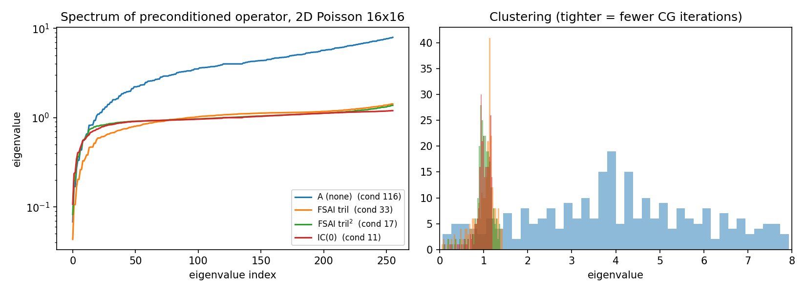

# Learned sparse preconditioners for conjugate gradient

A graph neural network predicts a sparse **lower-triangular factor G** of an approximate inverse, `M⁻¹ = GᵀG`,
for symmetric positive-definite systems `Ax = b`. The preconditioner is SPD by construction (positive diagonal of G),
applies with two sparse mat-vecs, and is trained without ever solving a linear system.

> **Status.** The numerical side (matrix generators, CG, IC(0), classical FSAI, graph construction, losses' math, solver
> wrapper, evaluation harness) is implemented and tested. The GNN training pipeline is implemented but **no trained-model
> results are reported yet**: the table in "GNN results" is intentionally empty until you run it. Nothing below claims
> that the GNN beats or matches FSAI.

## Method
- **Scaling.** `Â = D^-1/2 A D^-1/2` (unit diagonal). Model output is `G = I + ΔG`, so an untrained model *is* Jacobi.
- **Graph.** Homogeneous graph: node = row, edge = nonzero (COO row/col/data taken together). Predicted entries live on
  the lower-triangle pattern of A (`tril`) or of A² (`tril2`, 2-hop).
- **Model.** Linear encoder → 3 residual GINE message-passing layers (edge feature = Â_ij) → edge MLP predicting G_ij.
  Diagonal through softplus.
- **Preconditioner.** `G_A = Ĝ·D^-1/2`, `M⁻¹ = G_Aᵀ G_A`.
- **Losses.**
  - *Frobenius:* `‖GÂGᵀ − I‖²_F / n` (exact for n ≤ 1024, Hutchinson probes above).
  - *Kaporin:* `log(tr(GÂGᵀ)/n) − (2/n)Σ log g_ii`, which is `log K` (Kaporin conditioning number) up to a constant.
    Classical FSAI is exactly the minimizer of K on a fixed pattern.
- **Baselines.** none, Jacobi, IC(0) (own implementation), classical FSAI on `tril` and `tril2`, PETSc ILU/ICC/BoomerAMG
  (or pyamg fallback). `scipy.spilu` is deliberately **not** used with CG: its operator is non-symmetric (checked).

## Results so far (CG, rtol 1e-8, random RHS; `benchmarks/results/`)

CG iterations on 2D Poisson:

| Grid | None | Jacobi | IC(0) | FSAI (tril) | FSAI (tril²) |
|---|---|---|---|---|---|
| 16² | 52 | 52 | 20 | 31 | 22 |
| 32² | 101 | 101 | 35 | 58 | 41 |
| 64² | 198 | 198 | 65 | 114 | 81 |
| 128² | 385 | 385 | not run | 204 | not run |

Jacobi equals "none" because the Poisson diagonal is constant (a useful sanity check). FSAI(tril²) needs about 2.3× the
nonzeros of FSAI(tril). The classical FSAI numbers are the **targets** a learned model must reach.



Condition number of the preconditioned operator, Poisson 16²: A 116, FSAI(tril) 33, FSAI(tril²) 17, IC(0) 11.

### Does the training loss predict CG iterations? (`benchmarks/correlation_study.py`)
32 random Poisson-like matrices × 6 preconditioners of varying quality (Jacobi, three Jacobi↔FSAI blends, FSAI tril/tril²):

| Metric | Pooled R² (log-log vs relative iterations) | Within-matrix Spearman (mean / min) |
|---|---|---|
| Frobenius loss | 0.27 | 0.917 / 0.829 |
| Kaporin K | 0.19 | 0.998 / 0.986 |

Findings: (1) *within* a matrix, lower loss means fewer iterations, and Kaporin ranks essentially perfectly;
(2) *across* matrices neither is a good absolute predictor (pooled R² < 0.3), so an "R² > 0.7" target is not met and
should not be claimed; (3) Frobenius loss can mis-rank: a 75% FSAI / 25% Jacobi blend has *lower* Frobenius loss than
FSAI (0.121 vs 0.136) yet needs more iterations, while Kaporin orders them correctly. This motivates training on Kaporin.

## GNN results (fill in after running)

| Matrix | None | FSAI | GNN-Frobenius (tril) | GNN-Kaporin (tril) | GNN-Kaporin (tril²) |
|---|---|---|---|---|---|
| Poisson 64² | 198 | 114 | _TBD_ | _TBD_ | _TBD_ (FSAI tril²: 81) |
| Poisson 128² (unseen size) | 385 | 204 | _TBD_ | _TBD_ | _TBD_ |
| SuiteSparse (OOD) | _TBD_ | _TBD_ | _TBD_ | _TBD_ | _TBD_ |

Reproduce: see below, then `python scripts/evaluate_checkpoint.py --ckpt checkpoints/*.pt`.

## Reproduce
```bash
conda env create -f environment.yml && conda activate lpc && pip install -e .
python scripts/run_tests.py                      # or: pytest   (torch tests skip if torch is absent)
python scripts/day3_checks.py                    # gate: torch losses == numpy, overfit one matrix
python benchmarks/day1_baselines.py              # baseline table
python benchmarks/correlation_study.py           # loss-vs-iterations study
python benchmarks/spectrum_figure.py
python scripts/train.py --loss kaporin --pattern tril  --steps 4000
python scripts/train.py --loss frobenius --pattern tril --steps 4000
python scripts/train.py --loss kaporin --pattern tril2 --steps 4000
python scripts/train.py --loss kaporin --pattern tril  --steps 4000 --no_residual   # ablation
python scripts/fetch_suitesparse.py ACUSIM Pres_Poisson   # verify the matrix on sparse.tamu.edu first
python benchmarks/petsc_baseline.py --mtx data/Pres_Poisson.mtx
python scripts/evaluate_checkpoint.py --ckpt checkpoints/gnn_kaporin_tril.pt --mtx data/Pres_Poisson.mtx
```

## Layout
`src/lpc/` matrices, solvers (CG, IC(0)), fsai, graph, model, loss, precond, evaluate · `tests/` · `benchmarks/` ·
`scripts/` · `notebooks/results.ipynb`

## Limitations / honest notes
- Timing: iteration count is the primary metric. A Python pipeline is not compared by wall-clock against compiled PETSc;
  setup and per-apply time are recorded separately and only compared within one framework.
- Training distribution is Poisson-like 2D diffusion (sizes 8²–64², anisotropy, variable coefficients, Dirichlet/mixed BCs).
  Out-of-distribution generalization (e.g. FEM matrices) is a test, not an assumption.
- Hutchinson-estimated Kaporin loss is slightly biased (estimate sits inside a log); exact trace is used for n ≤ 1024.
- Pure-Neumann problems are singular and not generated.

## References (verify before citing)
Kolotilina & Yeremin (1993) and Kaporin (1994) on FSAI; Grote & Huckle (1997) on SPAI; Häusner et al. (2023) neural
incomplete factorization; Li et al. (2023) learned preconditioners for CG; Davis & Hu (2011) SuiteSparse.
