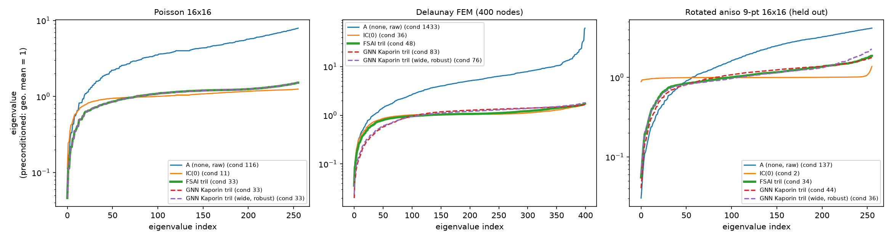

# Learned Sparse Preconditioners for Conjugate Gradient

> A graph neural network that predicts FSAI-style sparse approximate-inverse factors for symmetric positive-definite systems,
> benchmarked against IC(0), classical FSAI and algebraic multigrid, and analysed honestly, including where it fails.

 

## Overview

The conjugate gradient (CG) method solves `Ax = b` for symmetric positive-definite (SPD) `A`, but how many iterations it needs depends
on a *preconditioner* `M⁻¹ ≈ A⁻¹`. A classical sparse choice is **FSAI** (factorized sparse approximate inverse): it builds a
lower-triangular factor `G` with `M⁻¹ = GᵀG` by solving one small dense system per row. That is accurate but costs a loop of local solves
for every new matrix.

This project asks whether a **graph neural network (GNN)** can produce such a factor in a single forward pass, trained without ever
solving a linear system. The predicted preconditioner is SPD by construction (positive diagonal of `G`) and applies with two sparse
mat-vecs. The repository contains:

- a from-scratch library: matrix generators, CG with iteration counting, IC(0), classical FSAI, graph construction, the GNN, two training
  losses, and an evaluation harness (`src/lpc/`);
- trained checkpoints (`models/`), training logs (`logs/`) and every result file (`benchmarks/results/`);
- an analysis of *why* it works where it does and fails where it does (spectra, a loss-vs-iterations study, an out-of-distribution diagnostic);
- 35 tests and a one-command pipeline that regenerates every table and figure in this README.

## Key results

CG iterations to a relative residual of 1e-8 (fewer is better). Full tables and every other matrix are under [Results](#results).

<!-- GLANCE:START -->
| Matrix | none | IC(0) | AMG (pyamg) | FSAI (tril) | GNN Kaporin tril | GNN Kaporin tril (wide, robust) |
|---|---|---|---|---|---|---|
| Poisson 64² | 199 | 65 | 8 | 113 | 113 | 113 |
| Poisson 128² (unseen size) | 379 | n/a | 8 | 201 | 201 | 202 |
| Delaunay FEM, 4000 nodes | 660 | 102 | 21 | 123 | 161 | 157 |
| Q1 hex FEM 16³ (held out) | 35 | 16 | 5 | 22 | 44 | 22 |
| SuiteSparse Pres_Poisson (held out) | 2856 | n/a | 57 | 287 | ✗ no conv. (148220) | ✗ no conv. (148220) |
<!-- GLANCE:END -->

- **What works.** Trained with the Kaporin loss, the GNN reproduces classical FSAI iteration-for-iteration on every matrix family it has
  seen, including a grid size it never trained on (Poisson 128²), and cuts CG iterations by about 42–47% versus no preconditioner on the
  Poisson grids.
- **What does not.** It does **not beat** classical FSAI, IC(0) or AMG anywhere. On SuiteSparse Pres_Poisson every GNN variant that was run
  fails to converge, and on the held-out Q1 hex FEM matrix the standard variants are *worse than no preconditioner*. A degree-robust
  variant fixes the Q1 hex case (it matches FSAI) but not Pres_Poisson.
- **The honest framing.** Within a matrix family it has seen, a trained network can stand in for FSAI's per-row solves at the cost of one
  forward pass; outside it, nothing in this work shows reliable generalization (see [Findings](#findings) and [Limitations](#limitations)).

## Contents

[Installation](#installation) · [Quick start](#quick-start) · [How it works](#how-it-works) · [Experimental setup](#experimental-setup) ·
[Results](#results) · [Findings](#findings) · [Limitations](#limitations) · [Reproducing the results](#reproducing-the-results) ·
[Repository structure](#repository-structure) · [Testing](#testing) · [Data](#data) · [References](#references)

## Installation

Requires Python 3.10+. CPU only; no GPU is used. Developed and tested on macOS (Apple Silicon) with Python 3.14, PyTorch 2.15,
PyG 2.8, NumPy 2.5 and SciPy 1.18.

```bash
git clone <this-repository> && cd learned-preconditioners
python3 -m venv .venv && source .venv/bin/activate
pip install numpy scipy pandas matplotlib scikit-learn pytest jupyter ipykernel pyamg torch torch_geometric
pip install -e .
python scripts/run_tests.py        # expect: 35 passed, 0 failed
```

**Troubleshooting (macOS).** If `import lpc` fails after `pip install -e .` even though `pip show lpc` works, Python may be skipping the
editable-install `.pth` file because it carries macOS's *hidden* flag (`python -v -c pass 2>&1 | grep pth` then prints `Skipping hidden .pth file`).
`chflags nohidden .venv/lib/python3*/site-packages/*.pth` clears the flag but did not always stick. A regular install, `pip install .`, avoids
`.pth` files entirely (re-run it after editing `src/`), as does `export PYTHONPATH="$PWD/src"`.

`environment.yml` is a conda alternative that was not used for the reported results.

## Quick start

**1. Evaluate the shipped models** (no training needed). This runs CG with every baseline and each checkpoint on the benchmark matrices and
writes `benchmarks/results/eval_all.csv`:

```bash
python scripts/evaluate_checkpoint.py --ckpt models/gnn_kaporin_tril_final.pt --amg
```

**2. Use a model as a preconditioner for your own SPD matrix.**

```python
import numpy as np, scipy.sparse as sp, torch
from lpc.model import PrecondGNN
from lpc.precond import gnn_preconditioner
from lpc.solvers import cg_count
from lpc.matrices import poisson2d            # any SPD scipy sparse matrix works; this is just an example

ck = torch.load("models/gnn_kaporin_tril_final.pt", map_location="cpu")
model = PrecondGNN(residual=ck.get("residual", True), robust=ck.get("robust", False))
model.load_state_dict(ck["state"]); model.eval()

A = sp.csr_matrix(poisson2d(64))
b = np.random.default_rng(0).normal(size=A.shape[0])

M = gnn_preconditioner(model, A, ck["pattern"])    # scipy LinearOperator approximating A^-1
print(cg_count(A, b))                              # unpreconditioned: iterations, converged, relative residual
print(cg_count(A, b, M=M))                         # with the GNN preconditioner
# or directly: x, info = scipy.sparse.linalg.cg(A, b, M=M, rtol=1e-8)
```

> **Check before trusting it.** The model was trained on 2D/3D diffusion and Delaunay-FEM matrices with a handful of neighbours per row.
> On matrices with much denser rows it can be *worse than no preconditioner* (see [Findings](#findings)). Compare against Jacobi and
> unpreconditioned CG on your matrix first.

**3. Train your own.**

```bash
python scripts/train.py --loss kaporin --pattern tril --steps 4000       # writes checkpoints/gnn_kaporin_tril_final.pt
```

Options: `--loss {frobenius,kaporin}`, `--pattern {tril,tril2}`, `--dist {narrow,wide}`, `--robust`, `--no_residual`.

## How it works

```
A ──scale──▶ Â = D^-1/2 A D^-1/2 ──▶ graph (node = row, edge = nonzero) ──▶ GNN ──▶ G ──▶ M⁻¹ = (G D^-1/2)ᵀ (G D^-1/2) ──▶ CG
```

- **Scaling.** `Â` has unit diagonal. The network outputs `G = I + ΔG`, so an untrained model *is* Jacobi.
- **Graph.** Homogeneous graph with one node per row and one edge per nonzero (row, column and value are always taken together from COO).
  Predicted entries live on the lower-triangle pattern of A (`tril`) or of A² (`tril2`, 2-hop).
- **Model.** Linear encoder → 3 residual GINE message-passing layers (edge feature = `Â_ij`) → edge MLP that predicts `G_ij`; the diagonal goes
  through a softplus. The optional `--robust` variant uses mean aggregation and log-scaled degree inputs.
- **Preconditioner.** `G_A = Ĝ·D^-1/2` and `M⁻¹ = G_Aᵀ G_A` (checked against FSAI computed directly on the unscaled matrix).
- **Losses.**
  - *Frobenius:* `‖GÂGᵀ − I‖²_F / n` (exact for n ≤ 1024, Hutchinson probes above).
  - *Kaporin:* `log(tr(GÂGᵀ)/n) − (2/n)Σ log g_ii`, which equals `log K + (1/n) log det Â` for the Kaporin conditioning number K. Classical FSAI is
    exactly the minimizer of K on a fixed pattern, so on `tril` the best a trained model can do is match FSAI. K is scale-invariant, so the
    network's overall scale is arbitrary (a diagonal near 0.6 instead of 1 is not a bug).
- **Baselines.** none, Jacobi, IC(0) (own implementation), classical FSAI on `tril` and `tril²`, and pyamg smoothed-aggregation AMG.
  `scipy.spilu` is deliberately **not** used with CG: its operator is non-symmetric (verified).

## Experimental setup

- **Training matrices (generated):** 5-point diffusion on 8²–64² grids with random anisotropy, variable coefficients with contrast up to 1000,
  and Dirichlet or mixed boundaries. The *wide* distribution adds anisotropic 3D 7-point stencils and random Delaunay FEM meshes.
- **Test families:** training-like (Poisson 16²–128², anisotropic, random 2D), different structure (3D Poisson, Delaunay FEM), and **held out**
  even from the wide-trained models: a rotated-anisotropic 9-point stencil (positive off-diagonals, not an M-matrix), a Q1 hex FEM matrix
  (21 nonzeros per row), and SuiteSparse `ACUSIM/Pres_Poisson` (14,822 rows, 715,804 nonzeros, condition number about 2·10⁶, ~48 nonzeros per row).
- **Metric:** CG iterations to a relative residual of 1e-8 with a fixed random right-hand side per matrix (seeded by matrix name). Setup and
  per-apply times are recorded in `benchmarks/results/eval_all.csv`, but iteration count is the primary metric: a Python pipeline is not
  compared by wall-clock against compiled libraries. `tril²` uses about 2.3× the nonzeros of `tril`.
- **Checkpoints:** final weights after the last step. An early "best validation" checkpoint turned out to be misleading: it is the first step to
  reach the minimum on a plateau, and the validation matrix is in-distribution.

## Results

<!-- RESULTS:START -->
**CG iterations to relative residual 1e-8** (fewer is better; `n/a` = method not run / not applicable; `✗` = did not converge within 10·n iterations). Right-hand sides are seeded per matrix, so rows are comparable.

| Matrix | none | jacobi | IC(0) | AMG (pyamg) | FSAI (tril) | FSAI (tril²) | GNN Frobenius tril | GNN Kaporin tril² | GNN Kaporin tril | GNN Kaporin tril (wide) | GNN Kaporin tril (wide, robust) |
|---|---|---|---|---|---|---|---|---|---|---|---|
| **Training-like** | | | | | | | | | | | |
| Poisson 16² | 52 | 52 | 20 | 6 | 30 | 23 | 31 | 23 | 30 | 30 | 30 |
| Poisson 32² | 101 | 101 | 34 | 7 | 58 | 41 | 60 | 43 | 58 | 58 | 58 |
| Poisson 64² | 199 | 199 | 65 | 8 | 113 | 81 | 110 | 83 | 113 | 113 | 113 |
| Poisson 128² (unseen size) | 379 | 379 | n/a | 8 | 201 | 153 | 206 | 158 | 201 | 202 | 202 |
| Anisotropic 64² (ay=0.01) | 366 | 366 | 32 | 31 | 195 | 136 | 204 | 166 | 197 | 198 | 196 |
| Random 2D family #0 | 150 | 150 | 50 | 7 | 81 | 61 | 82 | 63 | 81 | 81 | 81 |
| Random 2D family #1 | 210 | 209 | 62 | 8 | 111 | 79 | 114 | 88 | 111 | 111 | 111 |
| Random 2D family #2 | 198 | 198 | 65 | 8 | 113 | 80 | 116 | 83 | 113 | 114 | 113 |
| **Different structure (in training only for the wide-trained models)** | | | | | | | | | | | |
| 3D Poisson 16³ | 64 | 64 | 23 | 6 | 36 | 27 | 38 | 32 | 37 | 36 | 36 |
| Delaunay FEM, 4000 nodes | 660 | 293 | 102 | 21 | 123 | 73 | 166 | 163 | 161 | 154 | 157 |
| **Held out (denser / not M-matrix)** | | | | | | | | | | | |
| Rotated aniso 9-pt 64² (held out) | 305 | 305 | 18 | 19 | 153 | n/a | 181 | n/a | 173 | 157 | 158 |
| Q1 hex FEM 16³ (held out) | 35 | 35 | 16 | 5 | 22 | n/a | 5551 | n/a | 44 | 350 | 22 |
| SuiteSparse Pres_Poisson (held out) | 2856 | 746 | n/a | 57 | 287 | n/a | ✗ no conv. (148220) | n/a | ✗ no conv. (148220) | ✗ no conv. (148220) | ✗ no conv. (148220) |

**GNN vs classical FSAI on the same pattern, and vs unpreconditioned CG** (`+x%` = x% more iterations than FSAI; `⚠` = worse than no preconditioner)

| Matrix | GNN Frobenius tril | GNN Kaporin tril² | GNN Kaporin tril | GNN Kaporin tril (wide) | GNN Kaporin tril (wide, robust) |
|---|---|---|---|---|---|
| Poisson 16² | +3% | +0% | +0% | +0% | +0% |
| Poisson 32² | +3% | +5% | +0% | +0% | +0% |
| Poisson 64² | -3% | +2% | +0% | +0% | +0% |
| Poisson 128² (unseen size) | +2% | +3% | +0% | +0% | +0% |
| Anisotropic 64² (ay=0.01) | +5% | +22% | +1% | +2% | +1% |
| Random 2D family #0 | +1% | +3% | +0% | +0% | +0% |
| Random 2D family #1 | +3% | +11% | +0% | +0% | +0% |
| Random 2D family #2 | +3% | +4% | +0% | +1% | +0% |
| 3D Poisson 16³ | +6% | +19% | +3% | +0% | +0% |
| Delaunay FEM, 4000 nodes | +35% | +123% | +31% | +25% | +28% |
| Rotated aniso 9-pt 64² (held out) | +18% | n/a | +13% | +3% | +3% |
| Q1 hex FEM 16³ (held out) | +25132% ⚠ | n/a | +100% ⚠ | +1491% ⚠ | +0% |
| SuiteSparse Pres_Poisson (held out) | ✗ no conv. ⚠ | n/a | ✗ no conv. ⚠ | ✗ no conv. ⚠ | ✗ no conv. ⚠ |

- **GNN Frobenius tril** is worse than no preconditioner on: Q1 hex FEM 16³ (held out); SuiteSparse Pres_Poisson (held out).
- **GNN Kaporin tril** is worse than no preconditioner on: Q1 hex FEM 16³ (held out); SuiteSparse Pres_Poisson (held out).
- **GNN Kaporin tril (wide)** is worse than no preconditioner on: Q1 hex FEM 16³ (held out); SuiteSparse Pres_Poisson (held out).
- **GNN Kaporin tril (wide, robust)** is worse than no preconditioner on: SuiteSparse Pres_Poisson (held out).
<!-- RESULTS:END -->

**Spectra.** `benchmarks/results/spectrum_gnn.png` shows the eigenvalues of the preconditioned operator `G A Gᵀ` (all plots are also in
`notebooks/results.ipynb`):



On these small matrices the GNN's operator has the same condition number as FSAI on Poisson 16² (33 vs 33) and about 1.6–1.7× FSAI's on a
400-node FEM mesh (83 narrow, 76 robust, vs 48). CG iterations scale roughly with √κ, which predicts iteration gaps of about 26–31% there, close
to the +31% (narrow) and +28% (robust) measured on the 4000-node mesh; on the held-out rotated-anisotropic stencil κ is 44 (narrow) and 36 (robust)
vs FSAI's 34, matching the +13% and +3% gaps in the table. This is a consistency check, not a proof.

## Findings

1. **The Kaporin-trained GNN reproduces FSAI on seen families.** Iteration counts equal FSAI's to within a couple of percent on Poisson
   16²–128² (128² is an unseen size), the random 2D family, anisotropic problems and 3D Poisson, and need about 53–58% of the unpreconditioned
   iteration count (Poisson 16²–128²).
2. **It does not beat FSAI.** Ties within one or two iterations are noise. This is expected: FSAI is the exact optimum of the objective on `tril`.
   IC(0) needs fewer iterations than FSAI or the GNN on every matrix where it runs, especially under strong anisotropy (about 6× fewer than the
   GNN on the anisotropic 64² problem). pyamg smoothed-aggregation AMG is far stronger still: 6–8 iterations on the Poisson grids and 57 on
   Pres_Poisson (FSAI: 287), so no argument for the learned preconditioner can rest on iteration count.
3. **Kaporin loss beats Frobenius loss, mostly.** With final weights the Kaporin model needs fewer iterations than the Frobenius model on 11 of
   the 12 matrices where both converge (typically by 1–6%), and is far more robust on the held-out Q1 hex matrix (44 vs 5551 iterations).
   The exception is Poisson 64², where the Frobenius model is 3% *below* FSAI (110 vs 113). That is the only place any model beat FSAI, it is not
   repeated at 16², 32² or 128² (+3%, +3%, +2%), and FSAI is not the Frobenius optimum, so it is not evidence of learning beyond FSAI. A first
   comparison on early checkpoints pointed the other way; that was a checkpoint-step confound. All of this is from one training seed.
4. **Loss as a proxy for iterations.** On 32 matrices × 6 FSAI-family preconditioners, the Kaporin value ranks preconditioners almost perfectly
   *within* a matrix (Spearman 0.998, min 0.986) versus 0.917 for the Frobenius loss. *Across* matrices neither is a good absolute predictor
   (pooled R² 0.19 and 0.27), so a pooled R² > 0.7 target is not met. The Frobenius loss can mis-rank: a 75% FSAI / 25% Jacobi blend has lower
   Frobenius loss than FSAI but needs more iterations.
5. **Wider pattern.** The `tril²` model beats classical `tril` FSAI, but only because it uses about 2.3× the nonzeros. Against FSAI on the same `tril²`
   pattern it is within 0–11% on the Poisson grids and random 2D matrices, but 19% behind on 3D Poisson, 22% behind on the anisotropic problem and
   about 2× behind on the Delaunay FEM mesh (+123%).
6. **Generalization is limited to what the model has seen.**
   - On Delaunay FEM the narrow model is about 31% behind FSAI; training on FEM meshes (wide) brings that down only to about 25%.
   - On Pres_Poisson all four GNN variants that were run fail to converge within the iteration cap (the `tril²` model is skipped there because the
     A² pattern is too dense; the early checkpoints converged, very slowly). On Q1 hex FEM the standard variants are worse than no
     preconditioner (44 narrow, 350 wide, 5551 Frobenius, against 35 unpreconditioned).
   - `scripts/diagnose_ood.py`: Pres_Poisson rows have 17–49 neighbours and off-diagonal sums up to 5.6, against 2–4 and ≤ 1.4 in training. Measured
     under the training objective, the GNN's Kaporin K is 2.9× FSAI's there while Jacobi's is only 1.5×: a genuine generalization failure of the
     model, not an evaluation artefact.
   - Widening the training distribution was mixed: it helped the rotated-anisotropic held-out matrix (about 13% behind FSAI → about 3%) but made
     the Q1 hex held-out matrix much worse (44 → 350).
7. **Degree-robust variant (partial success).** Mean neighbour aggregation and log-scaled degree / off-diagonal-sum inputs, trained on the same wide
   distribution as the non-robust wide model, so that comparison changes only the architecture. On the held-out Q1 hex matrix it needs 22
   iterations, identical to FSAI, against 350 for the non-robust wide model. Everywhere else it is indistinguishable from the non-robust wide
   model (rotated aniso 158 vs 157, FEM 157 vs 154, Poisson identical). It does **not** fix Pres_Poisson. The robust change bundles two
   modifications (aggregation and input scaling), so which one matters is not isolated; Pres_Poisson differs from the training data in more than row
   length (off-diagonal magnitudes, conditioning about 2·10⁶), which this change does not address. Measured under the training objective, the robust
   model's Kaporin K on Pres_Poisson is 2.4× FSAI's (non-robust: 2.9×; Jacobi: 1.5×), so it is still worse than Jacobi there. Single seed.
8. **Residual parametrization (`G = I + ΔG`).** Validation iterations on Poisson 32² are indistinguishable at 4000 steps with and without it; it only
   speeds up the first few hundred steps.

## Limitations

- **Single training seed** per configuration; differences of a few percent are not established. Only large effects (for example 44 vs 350
  iterations) should be read as real.
- **Generated training data.** Everything the model sees in training is synthetic 2D/3D diffusion or Delaunay FEM. Pres_Poisson is a single real
  matrix; one matrix does not establish behaviour on SuiteSparse in general.
- **Iterations, not time.** No claim is made about wall-clock speed-ups. Setup cost (a GNN forward pass) and per-apply cost are logged but are
  compared only inside one Python framework.
- **Baselines.** AMG (pyamg) is far ahead of every other preconditioner on iteration count; its setup and per-iteration cost are not compared here.
  PETSc (`petsc4py`/hypre) was not used; pyamg AMG and the in-repo IC(0) stand in. IC(0) is skipped above 4096 rows (pure-Python implementation) and
  can break down on non-M-matrices.
- **Hutchinson estimate** of the Kaporin trace sits inside a log and is slightly biased; the exact trace is used for n ≤ 1024.
- **Not covered:** GMRES / non-symmetric systems, matrices beyond ~15k rows, GPU timing, learned sparsity patterns.
- **Data access.** `sparse.tamu.edu` returned HTTP 403 for downloads during this work; the matrix was obtained from the older University of Florida
  mirror (`scripts/fetch_suitesparse.py` tries it first).

## Reproducing the results

```bash
python scripts/run_tests.py                       # 35 tests (the torch tests need torch + PyG)
python scripts/day3_checks.py                     # torch losses agree with numpy; overfit one matrix
python benchmarks/day1_baselines.py               # baseline table (Poisson)
python benchmarks/correlation_study.py            # loss-vs-iterations study
python scripts/fetch_suitesparse.py ACUSIM Pres_Poisson      # optional; see Data

python scripts/train.py --loss kaporin   --pattern tril  --steps 4000
python scripts/train.py --loss frobenius --pattern tril  --steps 4000
python scripts/train.py --loss kaporin   --pattern tril2 --steps 4000
python scripts/train.py --loss kaporin   --pattern tril  --dist wide --steps 4000
python scripts/train.py --loss kaporin   --pattern tril  --dist wide --robust --steps 4000
python scripts/train.py --loss kaporin   --pattern tril  --no_residual --steps 4000

bash scripts/finalize.sh                          # evaluate all final checkpoints, fill the tables above, draw figures, run the notebook
bash scripts/finalize.sh --report-only            # same, but reuse the existing eval_all.csv (fast)
python scripts/diagnose_ood.py --ckpt checkpoints/gnn_kaporin_tril_final.pt --mtx data/Pres_Poisson.mtx
bash scripts/clean_clone_check.sh                 # tests from a clean clone; no large files, hardcoded paths or keys
```

All training runs use seed 0 and the logs are in `logs/`. The checkpoints in `models/` are the ones behind the tables.

## Repository structure

```
.
├── src/lpc/                  # library
│   ├── matrices.py           #   generators: 2D/3D diffusion, anisotropic, Delaunay FEM, held-out matrices
│   ├── solvers.py            #   CG with iteration counting, Jacobi, IC(0)
│   ├── fsai.py               #   classical FSAI, Frobenius and Kaporin metrics
│   ├── graph.py              #   matrix -> graph, scaling, sparsity patterns
│   ├── model.py              #   PrecondGNN
│   ├── loss.py               #   Frobenius / Kaporin losses (exact and Hutchinson)
│   ├── precond.py            #   predicted factor -> SciPy LinearOperator
│   └── evaluate.py           #   evaluation harness
├── scripts/                  # train.py, evaluate_checkpoint.py, diagnose_ood.py, make_results_tables.py,
│                             # finalize.sh, fetch_suitesparse.py, day3_checks.py, run_tests.py, clean_clone_check.sh
├── benchmarks/               # baselines, correlation study, spectrum figures, results/ (CSVs, figures)
├── tests/                    # 35 tests
├── notebooks/results.ipynb   # all plots
├── models/                   # final checkpoints used for the reported results
├── logs/                     # training logs
└── data/                     # downloaded matrices (git-ignored)
```

`benchmarks/petsc_baseline.py` is a PETSc/pyamg baseline script that was not used for the reported results; the AMG numbers come from
`evaluate_checkpoint.py --amg`.

## Testing

`python scripts/run_tests.py` runs 35 tests covering: SPD and symmetry of every matrix generator; graph construction (row/column/value alignment,
explicit zeros, lower-triangle patterns); FSAI correctness (unit diagonal, exact inverse factor on a full pattern, minimizes the Kaporin value on its
pattern); the loss math checked against dense NumPy (residual identity, Hutchinson unbiasedness, trace estimator, the sign convention relating the
Kaporin loss to K); and the model (starts exactly at Jacobi, positive diagonal, SPD preconditioner, torch losses equal NumPy).

## Data

Matrices are generated, except `ACUSIM/Pres_Poisson`, which comes from the SuiteSparse Matrix Collection (Davis & Hu, 2011) and is **not**
redistributed here: `scripts/fetch_suitesparse.py ACUSIM Pres_Poisson` downloads it into `data/`.

## References

Verify these before citing; they are given from memory of the literature, not re-checked against the sources.

- L. Yu. Kolotilina and A. Yu. Yeremin (1993) and I. E. Kaporin (1994): factorized sparse approximate inverses (FSAI) and the Kaporin conditioning number.
- M. J. Grote and T. Huckle (1997): sparse approximate inverses (SPAI).
- P. Häusner et al. (2023): neural incomplete factorization.
- Li et al. (2023): learned preconditioners for conjugate-gradient PDE solvers.
- T. A. Davis and Y. Hu (2011): the University of Florida / SuiteSparse Matrix Collection.
